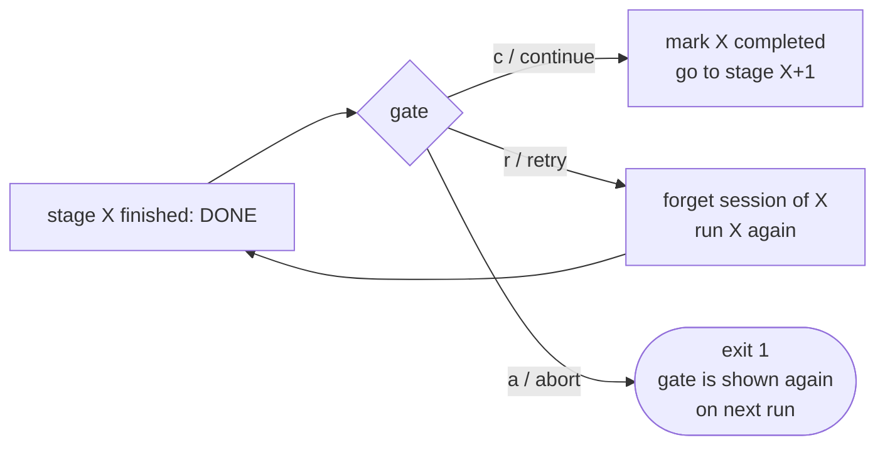
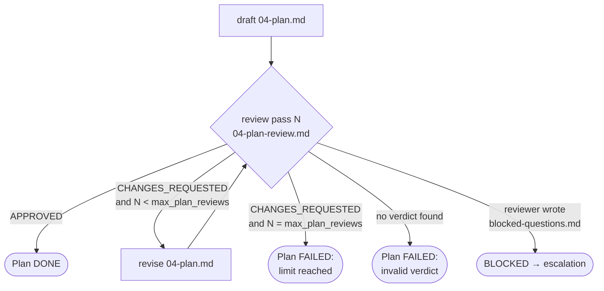
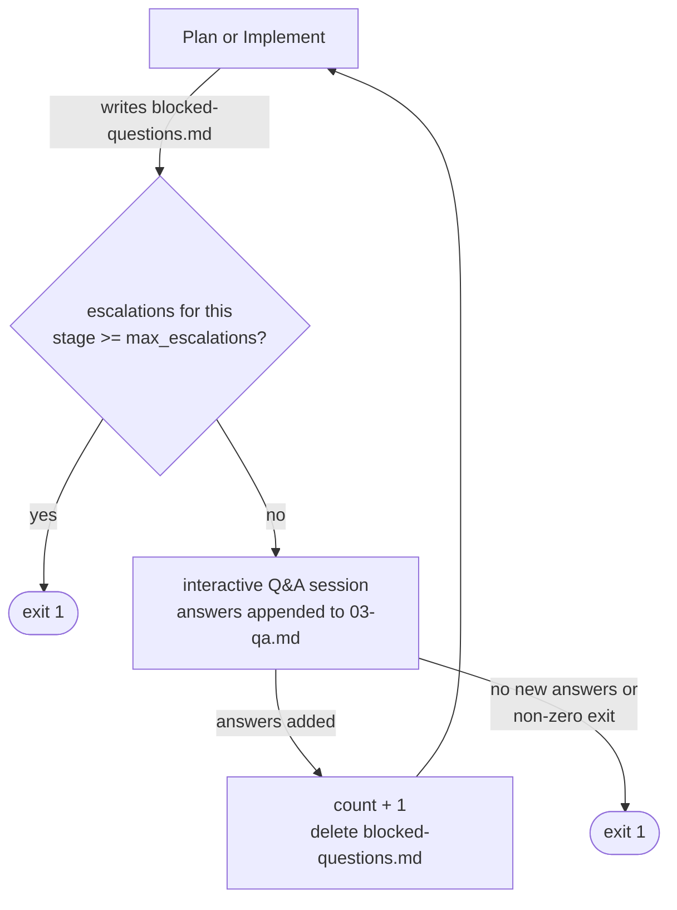
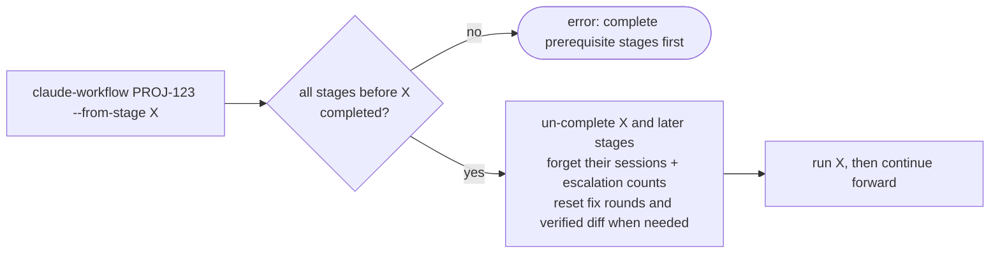

# 1. Flow of the steps

This document shows **how a ticket moves through the 8 stages**, and every way the flow can **go back** or **stop**.

All Python files mentioned live in `roles/ai/configuration/workflows/workflow/claude_workflow/`.

---

## 1.1 Main flow

Every stage that finishes normally is followed by an **approval gate**. At the gate you choose **continue**, **retry**, or **abort**.

```mermaid
flowchart TD
    START([claude-workflow PROJ-123]) --> INTAKE

    INTAKE[1. Intake<br/>headless] --> G1{gate}
    G1 -->|continue| EXPLORE[2. Explore<br/>headless, creates worktree]
    EXPLORE --> G2{gate}
    G2 -->|continue| QA[3. Q&A<br/>interactive]
    QA --> G3{gate}
    G3 -->|continue| PLAN[4. Plan<br/>headless, with review loop]
    PLAN --> G4{gate}
    G4 -->|continue| IMPL[5. Implement<br/>headless, test-first]
    IMPL --> G5{gate}
    G5 -->|continue| VERIFY[6. Verify<br/>no Claude, runs commands]
    VERIFY --> G6{gate}
    G6 -->|continue| REVIEW[7. Review<br/>headless, 2 lenses]
    REVIEW --> G7{gate}
    G7 -->|continue| RETRO[8. Retro<br/>interactive]
    RETRO --> G8{gate}
    G8 -->|continue| FINAL[Finalize:<br/>git commit in worktree]
    FINAL --> DONE([done: exit 0])

    PLAN -. writes blocked-questions.md .-> ESC[Escalation Q&A<br/>interactive]
    IMPL -. writes blocked-questions.md .-> ESC
    ESC -. re-run Plan .-> PLAN
    ESC -. re-run Implement .-> IMPL

    VERIFY -. a check fails .-> FIX{fix choice}
    REVIEW -. changes requested .-> FIX
    FIX -. fix .-> IMPL
```

**Legend**

- **Solid arrow** = normal forward path.
- **Dotted arrow** = loop back, with no new command needed.
- **Gate** = `[c]ontinue / [r]etry stage / [a]bort`. See 1.2.
- **Fix choice** = `[f]ix in Implement / [c]ontinue anyway / [a]bort`. See 1.3.

---

## 1.2 The approval gate (after every DONE stage)

Code: `pipeline.py:239-255`.



- With **`--auto`**, the gate always answers **continue**.
- With **`--only-stage X`**, the run stops right after **continue** on X.
- **Abort** keeps `approval_pending = true`, so the next run starts at the same gate.

---

## 1.3 Automatic loops (going back without a new command)

### Fix loop: Verify / Review → Implement

Verify (a check fails) and Review (a lens says `CHANGES_REQUESTED`) return **NEEDS_FIX**. Code: `pipeline.py:287-315`.

```mermaid
flowchart TD
    S[Verify or Review: NEEDS_FIX] --> AUTO{--auto?}
    AUTO -->|yes, rounds left| F
    AUTO -->|yes, no rounds left| STOP([exit 1])
    AUTO -->|no| ASK{"f / c / a"}
    ASK -->|f: fix<br/>only while rounds left| F[fix_rounds + 1<br/>fix_feedback = 06-verify.md or 07-review.md<br/>re-open Implement and later stages]
    ASK -->|c: continue anyway| NEXT[mark stage completed<br/>go to next stage]
    ASK -->|a: abort| STOP2([exit 1])
    F --> IMPL[Implement: "Fix the problems listed in ..."]
    IMPL --> V[Verify] --> R[Review]
```

- Default `max_fix_rounds` = **3**.
- Implement reads **only** the feedback file named in `fix_feedback`. It's cleared when Implement is completed.
- With `--only-stage`, choosing **f** saves the feedback and stops with: `Run: claude-workflow <T> --from-stage implement`.

### Plan review loop

Inside stage 4, a second Claude call reviews the plan. Code: `stages/plan.py:59-105`.



- Default `max_plan_reviews` = **2**.
- The verdict may have markdown around it: `# APPROVED`, `**Approved**` and `Changes requested:` all work (`parse_verdict`, `stages/base.py:154`).

### Escalation loop (blocked questions)

Only **Plan** and **Implement** can escalate. Code: `pipeline.py:272-285`.



- Default `max_escalations` = **3** per stage.
- An **empty** `blocked-questions.md` is deleted and ignored (`has_blocker`, `stages/base.py:167`).
- The counter resets when the stage is retried at the gate or re-run with `--from-stage`.

---

## 1.4 Stops, and how you go back by hand

When a stage returns **FAILED**, the program **stops with exit 1**. The stage stays recorded as `current_stage`, so running the same command again **re-runs that stage**.

| Where it stops | Why | What you do |
|---|---|---|
| Any stage | Claude exits non-zero, times out, or doesn't write a fresh artifact | Run the same command again |
| Intake | Ticket not fetched | Check `Atlassian-Rovo-MCP` (`claude` in the repo, then `/mcp`) |
| Plan | Review limit reached without `APPROVED` | Run again, or `--from-stage plan` |
| Explore … Review | `composer.lock` / `package-lock.json` differs from main | Run the install in the worktree on the host, run again |
| Verify | A command changed the diff (message lists the files) | Add generated files to `.gitignore`, run again |
| Verify / Review | Out of fix rounds (`--auto`) | Fix by hand, or `--from-stage implement` |
| Review | Worktree changed after Verify | `--from-stage verify` |
| Finalize (after Retro) | Worktree changed after Review | `--from-stage verify` |
| Escalation | Max escalations reached | `--from-stage <stage>` resets the counter |

---

## 1.5 Manual jump with `--from-stage`



- Code: `pipeline.py:219-235`.
- **X before Implement** (e.g. `plan`): the fix feedback is **cleared**, because a new plan makes it stale.
- **X = Implement**: the fix feedback is **kept**, and the fix rounds reset to 0.
- The **worktree is not reset**. Code changes from earlier runs stay in it.

---

## 1.6 Crash and resume

The state is saved to `state.json` **before** every stage starts (`pipeline.py:257-258`).

- If the process crashes or you press **Ctrl-C**, the next run starts at the **same stage**.
- **Q&A** and **Retro** resume the **same Claude session** if it was interrupted with Ctrl-C (exit code 130 or -2).
- Only **one run per ticket** at a time. A lock file (`.lock`) blocks a second run.
- `proj-123` and `PROJ-123` are the **same ticket** (the key is upper-cased).

---

## 1.7 ASCII version (for reading in the terminal)

```text
 START
   │
   ▼
 [1 Intake] ─gate─▶ [2 Explore] ─gate─▶ [3 Q&A] ─gate─▶ [4 Plan] ─gate─▶ [5 Implement]
                     (worktree)                         │  ▲              │  ▲  ▲
                                                        │  └─ revise ◀─┐  │  │  │
                                                        │   (review    │  │  │  │
                                                        │    loop)  ───┘  │  │  │
                                                        ▼                 ▼  │  │
                                                   blocked-questions.md ──▶ Escalation Q&A
                                                                         (re-runs Plan/Implement)
                                                                                │
 ─gate─▶ [6 Verify] ─gate─▶ [7 Review] ─gate─▶ [8 Retro] ─gate─▶ Finalize ─▶ DONE  │
             │                  │                                                 │
             ▼                  ▼                                                 │
        check fails      changes requested                                       │
             │                  │                                                 │
             └──▶ [f]ix / [c]ontinue anyway / [a]bort ── f (max 3 rounds) ────────┘

 gate = [c]ontinue → next stage   [r]etry → same stage again   [a]bort → exit, gate again next run
```
