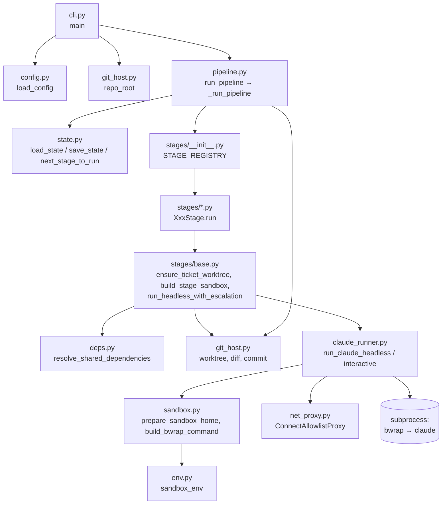
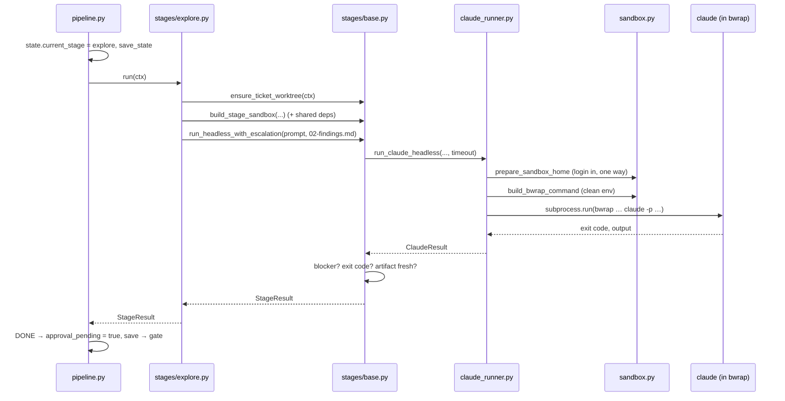

# 3. Flow of the code, grouped by file

This document follows **one run of the program** through the code. Each section is one file, in the order the code is reached.

All Python files live in `roles/ai/configuration/workflows/workflow/claude_workflow/`.

---

## 3.0 Call overview

---

## 3.1 `cli.py` — start

1. `main()` builds the argument parser.
2. Finds the **git root** (`repo_root`), so starting in a subfolder works.
3. Loads the config with `load_config(root, args.config_dir)`.
4. Calls `run_pipeline(...)`. Its return value becomes the **exit code**.

---

## 3.2 `config.py` — settings

`load_config(repo_root, config_dir)`:

1. Reads **two files** from the config folder (`--config-dir`, else `~/.config/claude-workflow`):
   - `global.config.json`: `kb-path`, `flake-path`, the limits, `stages`;
   - `repository/<repo-name>.config.json`: `commands`, `verify`, `docker-compose`, `shared-dependencies`, plus any override.
2. **A missing file is an error.** No repo file → *"copy example.config.json"*.
3. **Merges** them: objects merge per key (one stage field can be changed), lists are replaced.
4. **Validates** with `config.schema.json` plus cross checks (unknown commands, placeholders, invalid `pattern` regexes, ...). Each error names its **source file**.
5. Returns a frozen `WorkflowConfig`. `claude-workflow config check` runs the same checks.

---

## 3.3 `pipeline.py` — the orchestrator

### `run_pipeline()` (`pipeline.py:153`)

1. Checks the ticket looks like `ABC-123`, then **upper-cases** it.
2. Creates `<state_base>/<TICKET>/` and takes an **exclusive lock** on `.lock`.
3. Calls `_run_pipeline()`.
4. Turns errors into **exit 1**, and Ctrl-C into **exit 130**.

### `_run_pipeline()` (`pipeline.py:190`)

**Setup**

1. `load_state()`, plus safety checks (same ticket, same repo, expected worktree path).
2. `next_stage_to_run()` decides the start stage.
3. With `--from-stage`/`--only-stage`: un-complete later stages and reset their sessions, escalation counts, verified diff, and fix rounds/feedback (`pipeline.py:219-235`).

**Main loop**, for the stage at `idx`:

1. **Gate first?** If `approval_pending`, show the gate: `c` (for Retro → `_finalize()`), `r`, or `a`.
2. Set `current_stage`, **save state**.
3. A non-empty `blocked-questions.md` already exists for Plan/Implement → blocked without running Claude.
4. Otherwise `runners[stage].run(ctx)`.
5. **BLOCKED_QUESTIONS** → `_run_escalation_qa()` → count + 1 → delete blocker → same stage again.
6. **NEEDS_FIX** → `--auto` or `_prompt_fix()` → `f`: `_send_back_to_implement()` and jump to Implement; `c`: complete and go on; `a`: exit 1.
7. **FAILED** → print, exit 1.
8. **DONE** → `approval_pending = True`, save. The next loop shows the gate.

### Helpers

- `_prompt_gate()` (`:44`) and `_prompt_fix()` (`:56`) read your choice.
- `_send_back_to_implement()` (`:74`): un-complete Implement and later, `fix_rounds + 1`, set `fix_feedback`.
- `_run_escalation_qa()` (`:88`): interactive Q&A on the **ticket worktree**.
- `_mark_completed()` (`:131`): also clears `fix_feedback` when Implement completes.
- `_finalize()` (`:140`): diff check, `commit_stage(no_verify=...)`, diff check again.

---

## 3.4 `state.py` — checkpoint

- `TicketState` (`state.py:16`): ticket, current stage, completed stages, session ids, worktree, branch, base commit, escalation counts, approval pending, repo path, verified diff, **fix rounds**, **fix feedback**.
- `save_state()`: temp file + `fsync` + `os.replace` = **crash-safe**.
- `next_stage_to_run()`: `--from-stage` → else `current_stage` → else the first stage not completed.

---

## 3.5 `stages/base.py` — shared stage helpers

| Function | What it does |
|---|---|
| `ensure_ticket_worktree()` (`:57`) | Create or reuse the worktree; fix the base commit the first time; warn on a dirty main checkout |
| `_home_ro_mounts()` (`:97`) | `CLAUDE.md` for every stage; all skills for Retro |
| `build_stage_sandbox()` (`:109`) | Stage config → `SandboxSpec`, including shared-dependency mounts for the worktree |
| `parse_verdict()` (`:154`) | `APPROVED` / `CHANGES_REQUESTED` from the first line, markdown allowed |
| `has_blocker()` (`:167`) | True for a non-empty blocker file; deletes an empty one |
| `artifact_result()` (`:219`) | DONE only if the file is new or changed and not empty |
| `run_headless_with_escalation()` (`:232`) | Run Claude (with timeout) → check blocker → check exit code → check artifact |

---

## 3.6 `stages/*.py` — one file per stage

Each `run(ctx)` follows the same pattern: worktree (if needed) → sandbox → prompt → run Claude → `StageResult`.

| File | Special flow |
|---|---|
| `intake.py` | No repo. Adds a connector hint to the failure message |
| `explore.py` | Creates the worktree via `ensure_ticket_worktree` |
| `qa.py` | Saves the session id **before** starting; keeps it on Ctrl-C |
| `plan.py` | Draft → loop of review (checks blocker + verdict) and revise |
| `implement.py` | Test-first prompt with your check commands; the fix feedback file if set |
| `verify.py` | No Claude. Runs `verify` + `tests.txt` through `commands.render` and `runners.run`; diff before/after; NEEDS_FIX on failures, NEEDS_HUMAN on a host stop |
| `review.py` | Digest check, `diff.patch`, 2 lenses, NEEDS_FIX on changes requested |
| `retro.py` | Like `qa.py`, no repo; prints the paths for you first |

---

## 3.7 `claude_runner.py` — starting Claude

1. `claude_flags()` (`:49`): `--model`, `--effort`, `--permission-mode dontAsk`, `--tools`, **`--append-system-prompt <skills>`**, `--add-dir …`, `--allowedTools`, MCP flags.
2. `sandboxed_command()` is a context manager that:
   - copies the login in (`prepare_sandbox_home`);
   - writes the hook-free `settings.json` to a temp folder;
   - starts the proxy for no-network stages, logging to `proxy.log`;
   - yields the bwrap command (`_bwrap_for`).
3. `run_claude_headless()` (`:127`): `claude -p …`, captured output, timeout → return code 124.
4. `run_claude_interactive()` (`:161`): `claude --session-id …` or `--resume …`, your terminal.

---

## 3.8 `sandbox.py` — building the bwrap command

- `sandbox_paths()` (`sandbox.py:84`): where things appear **inside** the sandbox.
- `prepare_sandbox_home()`: refuses symlinks in the sandbox home, then copies the login in one way (`_copy_login_in`, compares `expiresAt`) with `_safe_copy` (random temp file + `os.replace`, never follows links).
- `sandbox_settings()` (`:186`): your settings without `hooks`.
- `tiocsti_disabled()` (`:211`): checks whether the kernel blocks terminal injection.
- `build_bwrap_command()` (`:219`), in order:
  1. `--new-session` **only** for headless runs (or when TIOCSTI is not blocked);
  2. new PID namespace, `/dev`, `/proc`, empty `/tmp` and `/home`, and `--unshare-net` if no network;
  3. **`--clearenv`** + `--setenv` for each allowed variable;
  4. read-only system paths, fake home, `~/.nix-profile`, the settings file, the home mounts (`CLAUDE.md`, skills);
  5. state dir → `~/notes`, masking `state.json`, `.lock`, `home/`;
  6. repo + hidden `.git` + read-only dependency overlays;
  7. KB, flake, MCP config;
  8. proxy socket + `socat` bridge script, if needed;
  9. `--chdir <workdir> -- <command>`.

---

## 3.9 `env.py` — the sandbox environment

- `sandbox_env(flake)`: allowlisted host variables + all dev shell variables. `PATH` = dev shell first, then your host `PATH`.
- `dev_shell_env(flake)`: runs `nix develop <flake> --ignore-environment` **once per process** and writes `env -0` to a temp **file** (a `shellHook` banner on stdout can't mix in). It skips invalid names, temp folders and shell bookkeeping.

---

## 3.10 `deps.py` — shared dependencies

- `resolve_shared_dependencies()` (`deps.py:34`): the 4 rules from doc 2, section 2.0.1. Returns `(host folder, repo-relative target)` pairs.

---

## 3.11 `net_proxy.py` — network allowlist

- `ConnectAllowlistProxy` (`net_proxy.py:49`): an HTTP `CONNECT` proxy on a Unix socket.
- It allows `api.anthropic.com` and `platform.claude.com` on port 443, and logs every decision (`_log`). The log is opened with `O_NOFOLLOW`, because the sandbox can write in that folder.

---

## 3.12 `git_host.py` — git on the host

Runs only **outside** the sandbox. Never pushes, fetches, or pulls.

- `repo_root()` (`:74`), `ensure_worktree()` (`:39`), `is_dirty()` (`:84`).
- `capture_diff()` (`:90`) and `diff_digest()` (`:113`).
- `changed_files()` (`:129`): which files differ between two captured diffs.
- `commit_stage()` (`:135`): `git add -A` + `git commit [--no-verify]`.

---

## 3.13 Sequence: one headless stage (e.g. Explore)

